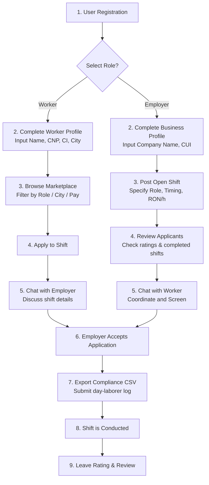

# GigTim — Product Brief & Requirements Specification

This document serves as a design brief for the **GigTim** platform. It outlines the core product concept, target user groups, functional feature requirements, and high-level user flows. The goal is to provide the designer with clear requirements on **what** the app is and **what** it needs to accomplish, leaving the creative execution, styling, branding, and layout decisions entirely to their expertise.

---

## 1. Product Concept & Market Context
**GigTim** is a local gig-economy marketplace connecting temporary day-laborers (*zilieri*) with hospitality (HoReCa) and local service businesses in Romania. 

Unlike general freelancer marketplaces, GigTim focuses on:
* **Immediate shift-based work**: Simple, short-term shifts (e.g., a waiter needed for 8 hours at an event, a barista for a weekend peak, or a dishwasher for a day).
* **Legal compliance**: Under Romanian day-labor law, employers must submit worker registration sheets to the ITM (*Inspectoratul Teritorial de Muncă*). The platform facilitates the gathering of compliant details (Romanian CNP and CI card series) to support this.
* **Reputation & reliability**: A strong rating and review system to ensure workers show up and businesses maintain safe, professional working environments.

---

## 2. Target User Personas & Goals

### A. The Worker (Zilier)
* **Who they are**: Individuals looking for flexible, quick-paying jobs, students, or hospitality professionals wanting to fill open days.
* **Core Goals**:
  - Browse and apply to shifts matching their role, location, and desired hourly rate.
  - Coordinate details with employers directly.
  - Track scheduled shifts and maintain a high reliability rating.
  - Quickly register, complete profile verification, and upload compliance data.

### B. The Employer (Business)
* **Who they are**: Restaurant owners, event organizers, café managers, or warehouse managers needing quick temporary staff.
* **Core Goals**:
  - Post open shifts with dates, duration, role descriptions, and hourly pay.
  - Review applications and select qualified candidates based on experience and ratings.
  - Start quick chat sessions with applicants to ask screening questions.
  - Accept workers and export their registration information to submit for local labor compliance (ITM).
  - Rate workers after the shifts are completed.

---

## 3. Core Features & Functional Requirements

### 1. Authentication & Role Selection
* **Sign Up / Sign In**: Email/password authentication.
* **Role Distinction**: Users must register as either a `WORKER` or an `EMPLOYER`.
* **Registration Fields**:
  - **Workers**: Name, phone, city, CNP (13-digit Romanian personal identification number), and CI series/number (National ID).
  - **Employers**: Company name, CUI (Romanian unique fiscal registration code), company headquarters address, and city.

### 2. Jobs Marketplace
* **Browse open shifts**: A feed showing active job listings.
* **Search & Filters**: Users need to filter by city location, job roles (e.g. Barista, Waiter, Dishwasher, Stagehand), and sort by date or pay rate.
* **Job Posting Details**: Displays company name, hourly pay in RON, shift duration, role category, start/end times, city location, and total estimated payout.
* **Apply Action**: Workers can apply to open shifts. Once applied, the option locks to prevent duplicate applications.

### 3. Messaging & Connection Hub
* **Employer-Worker Chat**: A messaging center enabling communication to coordinate shift logistics.
* **Chat Access Points**:
  - Employers can initiate a chat directly from a candidate's application card.
  - Workers can message an employer directly from a job posting details screen.
  - A directory of potential connections (employers see workers, workers see employers) is available to start discussions.

### 4. Shift & Application Tracker
* **Employers**:
  - Monitor active, upcoming, and past shifts.
  - View lists of candidates split by status: "În așteptare" (Pending evaluation) and "Procesate" (Accepted or Rejected).
  - Accept or reject candidates.
  - **ITM CSV Export**: Accepting a worker generates an easy CSV download containing the worker's full name, CNP, and CI details for legal labor reporting.
* **Workers**:
  - Track upcoming confirmed shifts they are scheduled to work.
  - View application status logs.

### 5. Profile & Reputation System
* **Reputation Metrics**: Display of reliability ratings, total completed shifts, and lists of past feedback reviews.
* **Zero Review State**: New users with 0 reviews need to display clean placeholder states (e.g., "0 recenzii") rather than default high ratings or empty stars to maintain credibility.
* **Verification Badge**: Indicators showing if a profile's ID verification is active or pending.

### 6. Community Forum
* **Discussion Threads**: Categorized discussions (e.g. General, Tips, Legal regulations) where users can post threads and reply with comments.

---

## 4. High-Level User Journey Flow

The following map outlines the steps users take to complete the core loop of finding/offering work:

